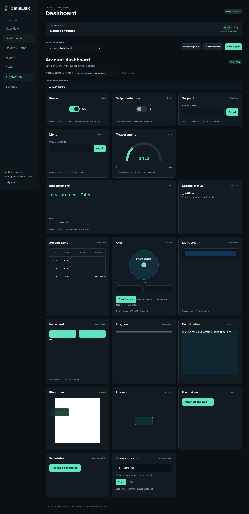

# OmniLink Web Client v0.6

A separate, installable web dashboard for the general-purpose OmniLink Server v0.6. Users can create dashboards, add/reorder/configure widgets, view reported state and telemetry, and send device commands. It is responsive across desktop and mobile browsers. The native mobile/desktop app is a later project.

This ZIP contains only the client source/assets, installer, and documentation. It has no database, broker, device secrets, or server application. Dashboard layouts remain on the server so the future app can use the same APIs. No aquarium channel labels or units are assumed.



## Connect to your existing server on Windows

1. Upgrade your existing server to v0.6 as described in its README, preserving `.env` and `data/`.
2. Extract this ZIP next to it, for example `D:\Projects\OmniLink_WebClient_v0.6`.
3. In Command Prompt inside this client folder run:

```bat
py -3 install.py --server-dir "D:\Projects\OmniLink_Server_v0.4"
```

Use your actual existing server folder; it does not need renaming. The installer only updates `OMNILINK_CLIENT_DIR` in that server's existing `.env`. It does not initialize a new server or change its password, encryption key, database, or certificates. Python's standard library is sufficient for the installer.

4. Restart the server with `run.bat`.
5. Open **http://localhost:8000/client/**. Server administration is at **http://localhost:8000/**. Use the exact hostname configured in `OMNILINK_PUBLIC_URL`; switching to 127.0.0.1 can cause Origin rejected.
6. Sign in with your OmniLink account. Select a device, choose **Edit layout → Add widget**, bind controls to the configured virtual channels, and **Save layout**.

New users choose **Create an account** on the sign-in page. Each account owns its devices and a default pool of 255 pins, V0–V254. Under **Devices & pins**, create devices and allocate free pins. Choose the device in each widget to combine several devices on a dashboard. A user login is different from the device ID/secret used by firmware or a simulator. Devices begin with no channels; browser/text widgets also work without hardware.

Deleting a widget releases its bound pins when the layout is saved. Shared widgets, flows and schedules block release with a dependency list. Cancel preserves the widget and pin. Legacy duplicate pins appear as conflicts; **Move** requires explicit acknowledgement that the firmware mapping must change. See the server's `docs/UPGRADE_v0.6.md` before upgrading an existing database.

Overview summarizes the account. Devices & pins shows details and the pool. History filters telemetry by device, metric and time range and exports CSV. Alerts displays flow alerts and acknowledgement. Automation provides draggable blocks, connections, draft/published versions and execution history. Settings lists browser capabilities and PWA installation.

## Linux and hosted deployment

Run `python3 install.py --server-dir /path/to/server`, then restart the server. The server mounts this independently packaged static folder at `/client/`; its API and live WebSocket stay on the same origin. Keep `OMNILINK_PUBLIC_URL` at the site's origin, for example `https://devices.example.com`, without `/client/` appended. HTTPS is required for remote browser sensors and app installation.

For the supplied Docker Compose stack: copy this package's `index.html`, `sw.js`, and `assets/` into the server's `web-client/` directory. Set `OMNILINK_CLIENT_DIR=/web-client` in the server `.env`, then run `docker compose up -d --build`. The provided Compose file mounts `./web-client:/web-client:ro`. Do not use the Windows/Linux installer for Docker because it writes a host filesystem path. No separate Python service is needed for this client.

The client can also be hosted by a separate static web service if its origin reverse-proxies `/api/*` and `/ws/live` to OmniLink and hosts the client at `/client/`. Preserve cookie/CSRF/Origin protections and configure that public origin on the backend. A separate cross-origin deployment is not preconfigured; `file://` and a plain static preview without the API proxy will not connect.

## Widgets

Charts display up to 1,500 recent telemetry records per device within the selected time window; use History for a larger filtered export.

All 15 previous widget types are retained; 12 additions bring the total to **27**. Joystick axes are separate commands. Floor-plan images accept PNG/JPEG/WebP up to 350 KB; maps use optional external tiles and keep coordinates visible if tiles cannot load.

Choose **Widget guide** on any dashboard to see setup instructions for all 27 types. The Add widget picker has a per-widget Help button, and each configuration form has expandable usage steps, pin requirements and browser-permission notes.

| Widget | Use |
| --- | --- |
| Switch / button | Send configured typed values |
| Slider / value input | Adjust a numeric channel or enter a typed value |
| Value / gauge / LED | Display reported/desired state or a measurement |
| Chart | Multiple devices/metrics; line, bar, point and state charts with a shared time window |
| Selector / joystick / colour | Named typed options, two numeric axes, #RRGGBB string output |
| Stepper / progress | Increment/decrement a numeric pin or display bounded progress |
| Schedule controls / status / table | Device schedules, connection status and current pin table |
| Navigation | Open another saved dashboard |
| Map | Latitude/longitude from two pins, optional OpenStreetMap tiles |
| Floor plan / process | Uploaded background with positioned live readings/equipment symbols |
| Text | Add instructions or labels |
| Browser location / motion | Read available browser sensor APIs |
| Camera / microphone | Local preview or relative level |
| BLE reader / Serial monitor | Read selected local peripherals when supported |

Reported, desired, and command outcomes are shown separately. A desired value becomes **applied** only after the connected device confirms the command. The default control option keeps server automation active. Pausing configured rules/schedules is optional, and is unrelated to any hardware-specific mode.

Browser inputs start only after an explicit user action/permission and stop when leaving the dashboard or signing out. These readings stay local; they are not automatically uploaded to device channels. Hardware/API availability varies by browser and OS. The dashboard remains usable when an input API is unavailable.

Use the browser's Install/Add to Home Screen action to install the PWA. Its manifest and service worker are scoped to `/client/`. Only public assets are cached; authenticated API data, credentials, and control requests are never cached or queued for offline sending. The public sign-in shell can open offline; live dashboards require the server.

## Update independently

Stop browser sensor sessions, replace this client folder's static assets with the next compatible release, and reopen/reload the dashboard. If you move the folder, rerun the installer and restart the server. The server package does not bundle these widget assets. Keep a copy of the old client for rollback. Shared server layouts are preserved, including existing custom widget names.

For flow blocks and execution limits, see the server’s `docs/FLOWS.md`. The editor saves its diagram as mxGraphModel XML and keeps the executable graph in the existing server schema.

See `API.md` for the API boundary and `VALIDATION.md` for actual test coverage.
